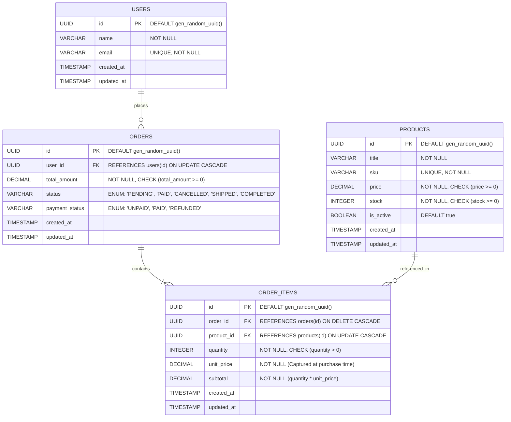
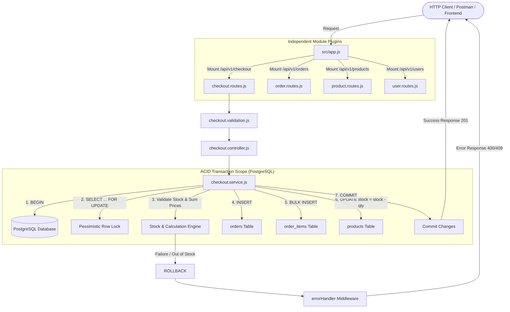
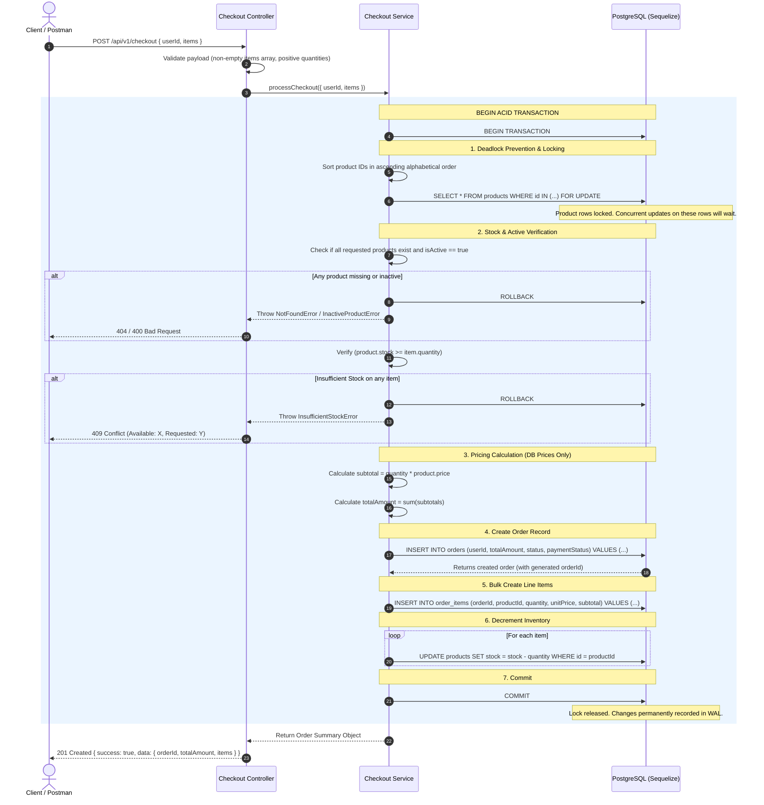
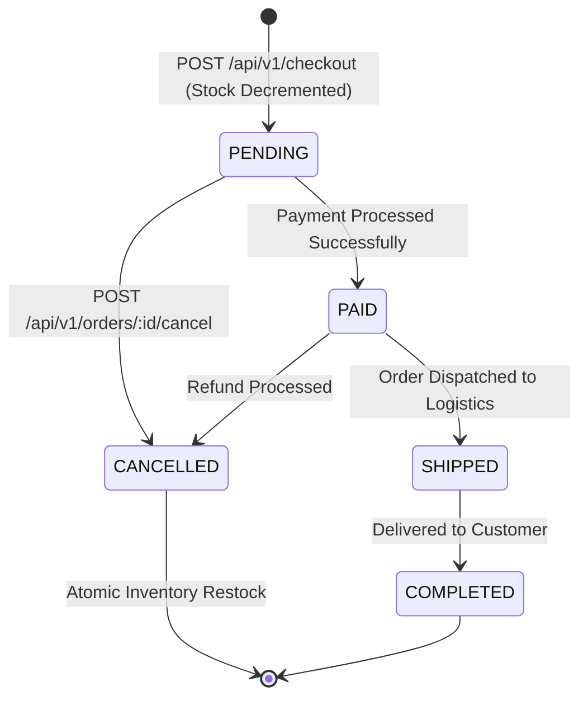

# E-Commerce Checkout & Order Engine (ACID Transactions)
## Complete Architectural & Execution Flow Specification

- **Target Stack:** Node.js (ES Modules), Express.js, PostgreSQL (pgAdmin 4), Sequelize ORM
- **Language:** JavaScript (`.js`)
- **Architecture Pattern:** Feature-Based / Modular (Vertical Slices) with Option 2: Self-Contained Module Plugin Pattern
- **API Versioning:** Version 1 (`/api/v1/...`)
- **Core Focus:** ACID Transactions (`BEGIN`, `COMMIT`, `ROLLBACK`), Pessimistic Row Locking (`FOR UPDATE`), Inventory Integrity (`CHECK stock >= 0`), and Order Lifecycle Management.

---

## Table of Contents
1. [Project Directory Structure](#1-project-directory-structure)
2. [Database Schema & ER Diagram](#2-database-schema--er-diagram)
3. [Component & Layer Flow Architecture](#3-component--layer-flow-architecture)
4. [The Checkout ACID Transaction Flow (Step-by-Step)](#4-the-checkout-acid-transaction-flow-step-by-step)
5. [Concurrency & Race Condition Protection](#5-concurrency--race-condition-protection)
6. [Order Lifecycle & Restocking Flow](#6-order-lifecycle--restocking-flow)
7. [Module Plugin Architecture (Option 2 Implementation)](#7-module-plugin-architecture-option-2-implementation)
8. [API Specifications & Sample Payloads](#8-api-specifications--sample-payloads)

---

## 1. Project Directory Structure

```text
c:\Users\ashis\Downloads\Techugo\Day-29\E-Commerce Checkout Engine\
├── package.json                   # "type": "module", dependencies: express, sequelize, pg, pg-hstore, dotenv
├── .env                           # Local environment configuration
├── .env.example                   # Example environment variables template
├── PROJECT_FLOW.md                # Complete architecture and flow specification
│
└── src/
    ├── config/
    │   ├── database.js            # Sequelize database connection instance & pool settings
    │   └── env.js                 # Centralized process.env validation & export
    │
    ├── database/
    │   ├── associations.js        # Relational mapping between models (hasMany, belongsTo)
    │   └── seedData.js            # Seeder for demo users and inventory items (for pgAdmin testing)
    │
    ├── middlewares/
    │   ├── errorHandler.js        # Global error handler (handles DB errors, ACID rollbacks, validation errors)
    │   └── notFound.js            # 404 handler for unregistered endpoints
    │
    ├── api/
    │   └── v1/
    │       └── modules/
    │           ├── products/
    │           │   ├── models/
    │           │   │   └── product.model.js       # Product table definition with CHECK (stock >= 0)
    │           │   ├── getAllProducts/
    │           │   │   ├── getAllProducts.service.js
    │           │   │   ├── getAllProducts.controller.js
    │           │   │   └── getAllProducts.routes.js   # GET /api/v1/products
    │           │   └── getProductById/
    │           │       ├── getProductById.service.js
    │           │       ├── getProductById.controller.js
    │           │       └── getProductById.routes.js   # GET /api/v1/products/:id
    │           │
    │           ├── orders/
    │           │   ├── models/
    │           │   │   ├── order.model.js         # Orders table definition (status, total amount)
    │           │   │   └── orderItem.model.js     # Order items table definition (captured unit price, subtotal)
    │           │   ├── getOrderById/
    │           │   │   ├── getOrderById.service.js
    │           │   │   ├── getOrderById.controller.js
    │           │   │   └── getOrderById.routes.js     # GET /api/v1/orders/:id
    │           │   ├── getOrdersByUser/
    │           │   │   ├── getOrdersByUser.service.js
    │           │   │   ├── getOrdersByUser.controller.js
    │           │   │   └── getOrdersByUser.routes.js # GET /api/v1/orders/user/:userId
    │           │   └── cancelOrder/
    │           │       ├── cancelOrder.service.js     # ACID Restocking Transaction
    │           │       ├── cancelOrder.controller.js
    │           │       └── cancelOrder.routes.js      # POST /api/v1/orders/:id/cancel
    │           │
    │           ├── users/
    │           │   ├── models/
    │           │   │   └── user.model.js          # Users table definition
    │           │   ├── getAllUsers/
    │           │   │   ├── getAllUsers.service.js
    │           │   │   ├── getAllUsers.controller.js
    │           │   │   └── getAllUsers.routes.js      # GET /api/v1/users
    │           │   └── getUserById/
    │           │       ├── getUserById.service.js
    │           │       ├── getUserById.controller.js
    │           │       └── getUserById.routes.js      # GET /api/v1/users/:id
    │           │
    │           └── checkout/
    │               ├── checkout.service.js        # ACID Transaction orchestration (Lock, Verify, Decrement, Commit)
    │               ├── checkout.controller.js     # Checkout HTTP handler
    │               ├── checkout.routes.js         # POST /api/v1/checkout
    │               └── checkout.validation.js     # Validates userId & items payload schema
    │
    ├── app.js                     # Express setup, middleware, and direct module plugin mounting
    └── server.js                  # Database connection verification, schema sync, and HTTP server startup
```

---

## 2. Database Schema & ER Diagram

The database enforces data integrity at the database engine level (PostgreSQL) using constraints and foreign keys.



### Critical Database Integrity Rules
1. **Immutable Historical Prices:** `order_items.unit_price` stores the exact price at the moment of checkout. Any future price updates to `products.price` will never alter past order records.
2. **Never Trust Client Prices:** The incoming API request only submits `productId` and `quantity`. Prices are always looked up directly from PostgreSQL.
3. **Check Constraints:** PostgreSQL enforces `CHECK (stock >= 0)`. If a concurrent bug or race condition ever attempts to push stock below zero, PostgreSQL rejects the query immediately with a constraint violation.

---

## 3. Component & Layer Flow Architecture



---

## 4. The Checkout ACID Transaction Flow (Step-by-Step)

The checkout process coordinates multiple tables in a single atomic database transaction.



### ACID Guarantees Explained:
- **Atomicity:** Wrapped inside `sequelize.transaction(async (t) => { ... })`. If any single operation fails (e.g., product out of stock, network glitch, database constraint violation), Sequelize triggers `ROLLBACK`. Zero partial data is saved.
- **Consistency:** The system transitions strictly from one valid state to another. Constraints (`CHECK (stock >= 0)`, `CHECK (price >= 0)`) ensure inventory numbers can never be corrupted.
- **Isolation:** `t.LOCK.UPDATE` issues `SELECT ... FOR UPDATE` in PostgreSQL. This guarantees serializability for inventory rows: no two transactions can read and decrement the same stock simultaneously.
- **Durability:** Once committed, records are persisted in PostgreSQL's Write-Ahead Log (WAL), surviving unexpected server restarts.

---

## 5. Concurrency & Race Condition Protection

### The Overselling Race Condition (Without Locking)
Imagine Product A has `stock = 1`. Two users click "Checkout" at the exact same millisecond:

```
[Time]   [Transaction 1 (User A)]              [Transaction 2 (User B)]
T1       Read Product A: stock = 1            Read Product A: stock = 1
T2       Stock >= 1: OK                       Stock >= 1: OK
T3       Write stock = 1 - 1 = 0              Write stock = 1 - 1 = -1 (OVERSELLING / CORRUPT!)
```

### The Solution: Pessimistic Row-Level Locking (`FOR UPDATE`)
```
[Time]   [Transaction 1 (User A)]              [Transaction 2 (User B)]
T1       SELECT ... FOR UPDATE (Acquires Lock) 
T2       Reads stock = 1                      SELECT ... FOR UPDATE (BLOCKED, Waits for T1)
T3       Decrements stock: 1 - 1 = 0          ... Waiting ...
T4       COMMIT (Releases Lock)               ... Waiting ...
T5                                            Lock Acquired! Reads stock = 0
T6                                            Stock Check: 0 < 1 -> REJECTED & ROLLBACK!
```

### Deadlock Prevention
When multiple items are purchased in different orders (e.g., Order 1 requests `[A, B]` while Order 2 requests `[B, A]`), a deadlock can occur if each transaction locks one product and waits for the other.
- **Remedy:** The `checkoutService` always **sorts product IDs in ascending alphabetical order** before requesting row locks. This enforces a consistent acquisition order across all threads, eliminating circular wait deadlocks.

---

## 6. Order Lifecycle & Restocking Flow



### Restocking Transaction Flow (Order Cancellation)
When an order is cancelled via `POST /api/v1/orders/:id/cancel`:
1. Check order status. If already `CANCELLED`, `SHIPPED`, or `COMPLETED`, reject the request.
2. Open a transaction (`BEGIN`).
3. Set `orders.status = 'CANCELLED'`.
4. Read all associated `order_items` for this order.
5. For each item, atomically increment inventory:
   ```sql
   UPDATE products SET stock = stock + item.quantity WHERE id = item.productId;
   ```
6. Commit transaction (`COMMIT`).

---

## 7. Module Plugin Architecture (Option 2 Implementation)

Each module is an autonomous, self-contained unit. It manages its own routes, validation, controller, service, and model. It explicitly exports its own `basePath` and `router`.

### Example Module Route (`src/api/v1/modules/checkout/checkout.routes.js`):
```javascript
import { Router } from 'express';
import { executeCheckout } from './checkout.controller.js';
import { validateCheckoutPayload } from './checkout.validation.js';

const router = Router();

// 1. Module declares its own mount path
export const basePath = '/api/v1/checkout';

// 2. Module routes
router.post('/', validateCheckoutPayload, executeCheckout);

export default router;
```

### Clean Mounting in `src/app.js` (No Central Aggregator File):
```javascript
import express from 'express';

// Direct module plugin imports
import checkoutRouter, { basePath as checkoutPath } from './api/v1/modules/checkout/checkout.routes.js';
import orderRouter, { basePath as orderPath } from './api/v1/modules/orders/order.routes.js';
import productRouter, { basePath as productPath } from './api/v1/modules/products/product.routes.js';
import userRouter, { basePath as userPath } from './api/v1/modules/users/user.routes.js';

import { errorHandler } from './middlewares/errorHandler.js';
import { notFoundHandler } from './middlewares/notFound.js';

const app = express();
app.use(express.json());

// Register modules directly
const modules = [
  { path: checkoutPath, router: checkoutRouter },
  { path: orderPath, router: orderRouter },
  { path: productPath, router: productRouter },
  { path: userPath, router: userRouter },
];

modules.forEach(({ path, router }) => {
  app.use(path, router);
});

// Error handling
app.use(notFoundHandler);
app.use(errorHandler);

export default app;
```

---

## 8. API Specifications & Sample Payloads

### 1. Checkout (Atomic Order Creation)
- **Method:** `POST`
- **URL:** `/api/v1/checkout`
- **Request Body:**
```json
{
  "userId": "3fa85f64-5717-4562-b3fc-2c963f66afa6",
  "items": [
    {
      "productId": "7ca95f64-5717-4562-b3fc-2c963f66af10",
      "quantity": 2
    },
    {
      "productId": "8ba95f64-5717-4562-b3fc-2c963f66af22",
      "quantity": 1
    }
  ]
}
```
- **Success Response (201 Created):**
```json
{
  "success": true,
  "message": "Order successfully created and inventory updated",
  "data": {
    "orderId": "91a85f64-5717-4562-b3fc-2c963f66af99",
    "userId": "3fa85f64-5717-4562-b3fc-2c963f66afa6",
    "status": "PENDING",
    "paymentStatus": "UNPAID",
    "totalAmount": 249.97,
    "items": [
      {
        "productId": "7ca95f64-5717-4562-b3fc-2c963f66af10",
        "quantity": 2,
        "unitPrice": 49.99,
        "subtotal": 99.98
      },
      {
        "productId": "8ba95f64-5717-4562-b3fc-2c963f66af22",
        "quantity": 1,
        "unitPrice": 149.99,
        "subtotal": 149.99
      }
    ],
    "createdAt": "2026-10-21T11:20:00.000Z"
  }
}
```
- **Error Response - Out of Stock (409 Conflict):**
```json
{
  "success": false,
  "error": "INSUFFICIENT_STOCK",
  "message": "Insufficient stock for product 'Wireless Mechanical Keyboard'. Requested: 5, Available: 2"
}
```

---

### 2. Get Order by ID
- **Method:** `GET`
- **URL:** `/api/v1/orders/:id`
- **Success Response (200 OK):** Returns order object with populated `items` and linked `product` details.

---

### 3. Cancel Order (Restock Inventory)
- **Method:** `POST`
- **URL:** `/api/v1/orders/:id/cancel`
- **Success Response (200 OK):**
```json
{
  "success": true,
  "message": "Order cancelled successfully and inventory has been restocked",
  "data": {
    "orderId": "91a85f64-5717-4562-b3fc-2c963f66af99",
    "status": "CANCELLED"
  }
}
```

---

### 4. Get All Active Products
- **Method:** `GET`
- **URL:** `/api/v1/products`
- **Success Response (200 OK):** Returns all products with their real-time `stock` levels and `price`.
